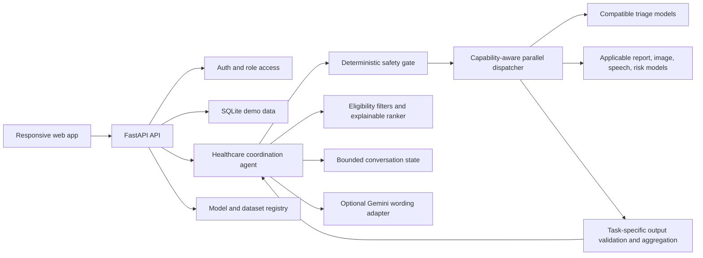

# SwasthyaAI Platform Design

**Status:** Proposed design for review  
**Date:** 2026-10-24

## Goal and scope

Build a runnable, extensible healthcare coordination application matching the user brief while honoring the supplied Sanocare hackathon task. The first complete local/demo release includes patient and clinician roles, symptom-care triage, emergency escalation, bounded conversation state, caregiver/doctor discovery, appointment requests, demo health records and reminders, multilingual text and browser voice, simulated education cases, and model integration points.

The supplied Sanocare labeled data consists of 340 synthetic requests, two multi-turn examples, and 60 synthetic caregivers; it is not clinical ground truth. No trained SwasthyaAI models, real clinician directory, validated image/report model, or backend service were found in the project. Additional models/datasets and an optional Gemini API key may be provided later. Implemented surfaces must distinguish working demo behavior from unavailable model capability. Do not imply diagnostic accuracy, clinical validation, real appointment confirmation, or real emergency dispatch.

Production use with real patient data is not in this design. It requires a separate security, privacy, clinical-safety, deployment, consent, and regulatory review. Demo health records are synthetic and local only.

## Requirement mapping

| User / challenge requirement | Design response | Evidence and limitation |
|---|---|---|
| Hindi, English, Hinglish symptom-care coordination | Text-first chat with language-aware prompts and best-effort browser speech (`hi-IN`, `en-IN`) | Dataset has three language labels but only 340 synthetic examples; Hinglish speech recognition is browser-dependent |
| Care type, urgency, red flags | Agent returns constrained care-navigation fields | This is triage/navigation, not disease diagnosis; labels are synthetic |
| Emergencies | Deterministic red-flag checks override model output, return `emergency_112`, no caregiver matches, and advise calling 112 | The dataset's red-flag vocabulary is illustrative, not clinically validated; detector must be transparent about limits |
| Missing information | Ask at most one concise follow-up at a time, persist bounded session state, then stop and safely fall back | No open-ended autonomous tool loops |
| Caregiver selection | Eligibility filters first; explainable weighted ranking second | Screenshot's illustrative ranking is configurable default; compare to dataset baseline in offline evaluation |
| Doctor discovery and booking | Search synthetic/demo clinician profiles and create an appointment request with a visibly demo status | No real provider network, calendar, payment, or confirmed appointment integration supplied |
| Medical records, allergies, medications, reports | Authenticated demo CRUD with patient ownership and role checks | Local synthetic records only; no real patient data or production storage/security claims |
| Wellness, reminders, dashboard | User-entered reminders and dashboard state; browser notification only when supported/authorized | No clinical recommendations or background notification service |
| Multiple models and datasets operating together | Capability-aware dispatcher runs all relevant registered adapters concurrently; dataset/model manifests retain task, schema, language, provenance, and validation metadata | No trained SwasthyaAI models are currently present; datasets are combined for training only when task/labels/schema/language are compatible, and parallel outputs are not blindly averaged |
| Optional generative chat (Gemini) | Configurable Gemini adapter may phrase a validated structured result or support general non-diagnostic interaction | No key supplied; disabled by default, external calls require consent/privacy controls, and Gemini cannot classify urgency or override safety rules |
| Reports, images, risk | Stable model-adapter registry and explicit `unavailable` status when no implementation is registered | No provided validated model/data for diagnosis, image analysis, or risk scoring; never fabricate output |
| Student education | Clearly labeled synthetic cases and learning flow | Not a substitute for supervised clinical education |
| Animated, responsive light interface | Responsive dashboard and conversational UI with restrained motion, reduced-motion support, and no dark/neon palette | Motion must not hide or delay safety information |

## Architecture



- **Web client:** React + TypeScript + Vite; accessible patient and clinician views, chat, records, appointments, reminders, discovery, and education. Use local CSS/Web Animations for modest transitions; respect `prefers-reduced-motion`.
- **Backend:** Python FastAPI with a versioned JSON API. SQLite is only the local/demo persistence layer. Server-side role checks and record ownership apply to every protected operation.
- **Agent:** A deterministic orchestration layer receives a message, updates bounded session context, checks emergency red flags before invoking a model, requests one follow-up when required, invokes an available model adapter, validates its output, ranks eligible caregivers, and returns a structured user-facing answer. It never returns private reasoning traces.
- **Model and dataset boundary:** Each adapter declares `name`, `version`, `capabilities`, task, input/output schema, language coverage, availability, and validation metadata. Dataset manifests record provenance, license, task, labels/schema, language coverage, and split strategy. Compatible datasets may be combined for a specific training task; incompatible tasks/schemas stay separate. The runtime concurrently invokes every available adapter relevant to the current request, not unrelated models, with per-adapter timeout and failure isolation. Task-specific aggregation validates outputs and confidence; disagreement or missing required results yields uncertainty/human review, never a blind average. All adapters remain subordinate to deterministic safeguards.
- **Generative model boundary:** Gemini is optional and disabled unless configured. It may translate/rephrase validated structured output or support general non-diagnostic conversation; it cannot decide urgency, care type, diagnoses, or emergency handling. External calls require explicit consent and data minimization; no personal health record is sent to a provider by default. `GEMINI_API_KEY` is read from ignored local environment configuration and never committed. If the key/provider is absent, slow, or fails, deterministic templates remain available.
- **Data boundary:** Supplied synthetic files are read-only seed/evaluation inputs, kept outside version control. Do not copy datasets, trained weights, secrets, uploaded files, or real personal health information into Git.

## Agent contract and workflow

Public Python interface:

```python
run_healthcare_agent(session_id, user_message, context=None) -> AgentResponse
```

HTTP interface: `POST /api/v1/agent/turn` with `{ "session_id": "...", "user_message": "...", "language": "auto", "location": {"lat": 28.54, "lng": 77.27} | null, "external_ai_consent": false }`. External provider use is off unless the user explicitly sets `external_ai_consent` to `true` for that turn.

`AgentResponse` fields:

```json
{
  "session_id": "demo-session",
  "status": "needs_follow_up | decision | emergency | unavailable",
  "response": "Plain-language, non-diagnostic care-navigation text",
  "follow_up_question": null,
  "care_type": "home_nursing | paramedic_home_visit | lab_test_home | teleconsultation | emergency_112 | null",
  "urgency": "emergency | same_day | scheduled | null",
  "safety_flags": [],
  "matched_caregivers": [],
  "models": [{"name": "...", "version": "...", "task": "care_triage", "status": "used | unavailable | failed", "confidence": null}],
  "aggregation_status": "agreed | single_model | disagreement | fallback",
  "needs_human_review": true,
  "disclaimer": "This demo is not a medical diagnosis or emergency service."
}
```

Workflow and stopping rules:

1. Validate message size, session ID, language, and optional coordinates.
2. Normalize text for matching without losing the original user text.
3. Run deterministic emergency checks first. A match immediately returns `emergency`, advises calling 112, omits caregiver matching, and does not wait for a model.
4. For non-emergency messages, use explicit conversation state and at most one follow-up question per turn. A session may ask no more than two follow-up questions total; after that, return `unavailable`/human-review guidance rather than loop.
5. Dispatch concurrently to every configured adapter relevant to the request's task, each with an independent timeout. Validate schemas, task identity, language support, and confidence; never infer a disease or prescribe treatment. A missing/unavailable adapter uses a safe fallback; disagreement among required compatible triage outputs returns uncertainty/human review, not a blind average.
6. Optionally pass only the validated result and minimal consented text to Gemini for wording. Gemini cannot alter structured fields or safety flags; if absent or failing, use deterministic templates.
7. Apply service eligibility filters, then rank eligible caregivers. Return concise, factual reason factors, not hidden model reasoning.
8. Persist only the minimum session fields required for the demo and return a stable response. On adapter/data failures, include per-model statuses and set `aggregation_status` to `fallback` or `disagreement`.

## Safety and matching policy

- Deterministic emergency rules take precedence over all model outputs. Dataset red flags include chest pain, breathlessness, unconsciousness, severe bleeding, stroke symptoms, seizure, high fever in an infant, suicidal ideation, and severe dehydration. Rules require negation/quotation/context checks where feasible; ambiguous danger language is escalated to a human/emergency guidance rather than suppressed.
- Emergency responses say to call 112 in India immediately, not to wait for a home caregiver or the app. The app does not dispatch emergency services.
- No diagnosis, medication changes, prescriptions, or individualized treatment plans. Give only care-navigation guidance and encourage professional evaluation when uncertain or worsening.
- Ranking Stage 1 excludes any caregiver failing mandatory qualification, care-type skill, service area, active status, or availability. No rating can compensate for a failed filter. Emergency requests always yield zero matches.
- Ranking Stage 2 defaults to the user-provided illustrative formula `S = 0.35K + 0.25D + 0.20A + 0.10L + 0.10R`, with each factor normalized to `[0,1]`. Teleconsultation ignores distance. Offline evaluation also computes the dataset reference (`0.35L + 0.30D + 0.20K + 0.15R`) so the chosen default is measurable rather than conflated with the supplied labels. Return factors that explain each match.
- Model explanations are limited to validated input factors and adapter-provided feature summaries. Never invent evidence, sources, or certainty.

## Platform modules and API boundaries

- Auth: patient/clinician registration and login for local demo, role checks, logout. No third-party identity provider is configured.
- Patient: profile, synthetic health-record CRUD, allergies/medications/history, reminders, and their own appointment requests. Records remain local and user-owned.
- Clinician: demo profile, specialties, languages, availability, and appointment-request inbox; never expose another patient's records without explicit authorized access.
- Discovery: search/rank demo clinician and caregiver data; all seed profiles visibly marked synthetic.
- Agent: `POST /api/v1/agent/turn`; `GET /api/v1/agent/sessions/{id}` for authorized bounded context only.
- Appointments: create/cancel demo requests; response status is `requested`, never `confirmed` absent a real scheduling integration.
- Model/data status: `GET /api/v1/models` lists adapters and explicit unavailable capabilities; a dataset manifest records provenance, license, task/schema, languages, and train/validation/test splits. `GET /api/v1/datasets` exposes safe metadata only, never raw private paths or data.
- Gemini: optional wording adapter configured by `GEMINI_API_KEY`; do not include the key in settings, logs, client code, or commits. External provider use is disabled until the user has explicitly consented to the applicable data transfer.
- Reports/images: upload and analysis endpoints remain unavailable until secure storage, consent, supported formats, validated model, and retention/deletion behavior are supplied. UI must not accept/store sensitive uploads as a pretend feature.
- Education: synthetic case catalog and progress stored separately from patient records.

API errors use a consistent `{ "error": { "code": "...", "message": "...", "request_id": "..." } }` response. Invalid requests return 400/422; unauthenticated/unauthorized operations return 401/403; missing resources 404; unavailable model capability 503; unexpected errors return 500 without stack traces or personal data.

## Delivery increments

Each increment must remain runnable, include focused tests and docs, be committed separately on `feature/swasthya-platform`, and be pushed to the existing GitHub remote only after its checks pass:

1. **Foundation:** repository setup, FastAPI/Vite app shell, API schema, local SQLite config, security defaults, and health/status endpoints.
2. **Agent and matching:** deterministic safety gate, conversation state/stop condition, dataset/model manifests, concurrent capability-aware adapter dispatch, task-specific aggregation, optional Gemini wording adapter, synthetic-data evaluation, eligibility-first caregiver ranking, tests, and legacy `/assess` compatibility.
3. **Accounts and core coordination:** patient/clinician roles, demo profile/records/reminders/appointments, ownership/authorization tests, and synthetic seed data.
4. **Frontend:** responsive light dashboard, chat flow, discovery, records, reminders, appointment requests, accessible animation and reduced motion.
5. **Extensions and hardening:** voice best-effort support, educational cases, model/dataset/provider status, unavailable states for unsupported report/image analysis, external-provider consent, end-to-end tests, setup and limitations docs.

Do not claim production readiness from these demo increments. Additional real models, external APIs, real appointments, image analysis, and production health-data use require their own integration, validation, privacy, and security gates.

## Acceptance tests

- Normal English, Hindi, and Hinglish request produces a valid structured outcome or a clear fallback.
- Ambiguous and incomplete request asks a concise follow-up; repeated turns stop at the configured limit.
- Potential emergencies in supported language variants override model results, return 112 guidance, and never return caregiver matches.
- Negation/quoted red-flag examples are tested to reduce avoidable false escalations without suppressing uncertain emergencies.
- Unsupported language and unavailable/malformed model produce a safe, explicit fallback.
- Relevant adapters start concurrently, are isolated by timeout/failure, report per-model status, and produce deterministic agreement/disagreement/fallback outcomes; unrelated adapters are not called.
- Compatible dataset metadata is validated before combined training; incompatible task/label/schema datasets remain separate. No raw data or API secrets are exposed by status routes.
- Gemini missing key, timeout, refusal, or malformed wording falls back to templates; Gemini output cannot change safety flags or structured care fields, and no external health-data transfer occurs without consent.
- Ineligible caregivers never rank; distance, skill, availability, language, and rating factors are independently tested; emergency has no matches.
- Patient/clinician authorization prevents cross-role and cross-patient record access.
- Appointment request never claims confirmation; unavailable image/report models are clearly unavailable.
- Responsive layout, keyboard flow, screen-reader labels, and reduced-motion behavior are checked.
- All shipped demo data is synthetic; no secrets, private datasets, or model artifacts are committed.
